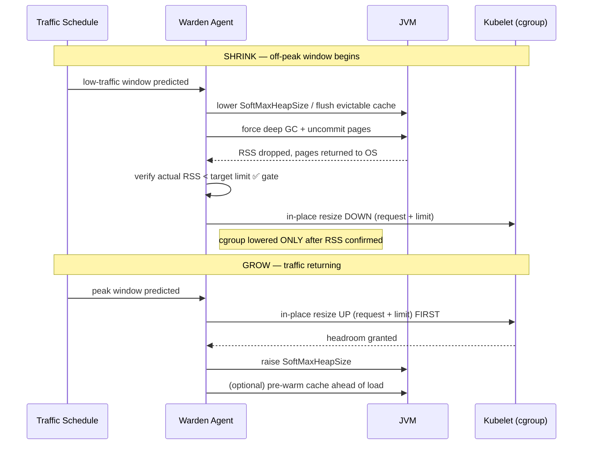

# mnemo-jvm-warden

[](https://github.com/baokhang83/mnemo-jvm-warden/actions/workflows/build.yml)
[](https://baokhang83.github.io/mnemo-jvm-warden/)
[](https://central.sonatype.com/search?q=g:io.github.baokhang83.mnemo%20%20a:warden-boost-client)

**JVM-aware vertical right-sizing for Kubernetes.** Warden makes a running JVM give memory
back to the OS during predictable low-traffic windows, then safely lowers the Pod's resource
footprint — reclaiming idle infrastructure without killing the pod, dropping its warm state, or
risking your high-availability posture.

And when an application needs that memory back for a bounded piece of work, it can **ask for
it in Java** — no `kubectl`, no Kubernetes credentials:

```java
try (BoostLease lease = WardenBoostClient.discover().acquireBoost(
        "index-rebuild", Duration.ofMinutes(2))) {
    rebuildIndex();
}
```

---

## When you need it

In ~95% of production environments, [Horizontal Pod
Autoscaling](https://kubernetes.io/docs/tasks/run-application/horizontal-pod-autoscale/) is the
right answer, and Warden does **not** compete with it. Warden is for the cases where removing
replicas isn't an option and shrinking the pods you keep is the only lever left:

- **Minimum-replica HA baselines** — 3 services × 3 replicas × 3 AZs can't scale to zero. At
  4 GB per JVM that's 36 GB reserved overnight to serve no requests. Warden shrinks each
  replica instead of removing any.
- **Slow-booting monoliths** — a 2–5 minute boot makes scale-to-few a liability at the next
  traffic spike. Warden keeps pods warm (JVM up, pools primed) and resizes in under a second.
- **Stateful nodes & distributed caches** — killing a replica forces rebalancing and cache
  loss. Warden shrinks in place, keeping the hot working set intact.

Savings are real only if something consolidates the freed capacity: Warden lowers the Pod's
*request*, which frees schedulable room, but a [Cluster
Autoscaler](https://github.com/kubernetes/autoscaler/tree/master/cluster-autoscaler) (or
equivalent) is what turns that into a smaller bill.

→ **[Why Warden](docs/why-warden.md)** has the worked numbers, the requests-vs-limits argument,
and the per-collector JVM knobs (`SoftMaxHeapSize`, Shenandoah uncommit, G1 periodic GC).

---

## The safety handshake

You can't change `-Xmx` on a running JVM, but you *can* move its soft ceiling and committed
memory. Warden's job is to coordinate that with a Kubernetes [in-place Pod
resize](https://kubernetes.io/docs/tasks/configure-pod-container/resize-container-resources/) —
which the JVM cannot do on its own.

The shrink and grow sequences are **not symmetric**. Get the order wrong and you `OOMKilled`
the pod. This ordering is the core correctness guarantee of the tool:



- **Shrinking:** shrink the JVM first, *verify RSS actually fell*, **then** lower the cgroup.
  Lowering the cgroup first = instant OOMKill.
- **Growing:** raise the cgroup **first**, then the JVM's soft max. Give headroom before the
  JVM tries to use it.
- **Cache re-warming** happens *ahead* of the predicted traffic return — a flushed cache is
  itself a cold start.

→ **[Architecture](docs/architecture.md)** for components, the full state machine, and
invariants.

---

## Boost: let the application ask for memory

Scheduled right-sizing handles the predictable curve. **Boost** handles the thing a schedule
can't know about: a bounded, named operation — an index rebuild, a nightly batch, a migration —
that needs headroom *now* and gives it back when it's done.

Add a named Boost to the policy, so the operator decides what the application is allowed to
ask for:

```yaml
spec:
  profiles:
    maintenance: { request: 1Gi, limit: 2Gi }
  boosts:
    index-rebuild:
      profile: maintenance
      heapTarget: 1Gi
      acquisitionTimeout: 2m
      maxDuration: 20m
```

Then the application takes a lease. `warden-boost-client` (Java 21, no third-party
dependencies) is published on [Maven Central](https://central.sonatype.com/artifact/io.github.baokhang83.mnemo/warden-boost-client):

```xml
<dependency>
  <groupId>io.github.baokhang83.mnemo</groupId>
  <artifactId>warden-boost-client</artifactId>
  <version>0.2.1</version> <!-- see the Maven Central badge above for the latest -->
</dependency>
```

It talks only to a loopback API served by the Warden sidecar — the app never holds Kubernetes
credentials:

```java
WardenBoostClient warden = WardenBoostClient.discover();

try (BoostLease lease = warden.acquireBoost("index-rebuild", Duration.ofMinutes(2))) {
    // Reached only after a durable Granted — never for a merely pending request.
    rebuildIndex();
    // close() requests completion; it is idempotent and does not block on reclamation.
} catch (BoostRejectedException e) {
    // Definite: this request will not be granted. No lease was handed out.
    log.warn("boost rejected: phase={} {}", e.phase(), e.getMessage());
} catch (BoostAcquisitionTimeoutException e) {
    // Uncertain, not failed: the grant may still be racing server-side, so the client
    // deliberately leaves the request alone. Persist the stable ID and reconcile later with
    // warden.inspect(id), or resume the wait via acquireBoost("index-rebuild", id, timeout).
    reconcileLater(e.requestId());
}
```

`discover()` reads the sidecar's own defaults from the environment, so an app container usually
needs **no** extra configuration — only the shared token volume mount. Under the hood: a
pod-bound bearer token the agent generates and shares over an `emptyDir`, Kubernetes
`ValidatingAdmissionPolicy` rules binding every self-requested boost to the requesting Pod's
own identity, and RBAC that never grants the agent `delete` or the `status` subresource.

The two failure modes being *separate types* is deliberate. A caller cannot accidentally treat
"definitely rejected" as "might still be granted" — because an uncertain grant that gets
released is an operation that may already be running without its memory floor.

Warden prepares the allocation *and* the JVM before it records a grant, then returns the Pod to
its current policy target once the lease closes. Boost is entirely opt-in: scheduled
right-sizing works exactly the same without ever creating a Boost request.

→ **[Boost guide](docs/warden-boost.md)** for the full lifecycle, the opt-in security package,
phase reference, and trust assumptions. Boost is **experimental**; see [Status](#status) below.

---

## Warden vs. VPA

Warden's real neighbor isn't HPA — it's the [Vertical Pod
Autoscaler](https://github.com/kubernetes/autoscaler/tree/master/vertical-pod-autoscaler),
which now also supports in-place updates. The difference is that VPA is **JVM-blind**:

| | VPA | mnemo-jvm-warden |
|---|---|---|
| Resizes the Pod in place | ✅ | ✅ |
| Can *cause* the JVM to release memory | ❌ observes RSS, can't move it | ✅ drives soft-max, GC, uncommit |
| Coordinates GC/uncommit with the resize | ❌ | ✅ ordered handshake |
| Understands cache / working-set state | ❌ | ✅ flushes evictable, keeps hot set |
| Driven by predicted traffic curves | ❌ reactive to observed usage | ✅ proactive, schedule-aware |
| Lets the application request headroom for a job | ❌ | ✅ Boost lease API |

> **VPA resizes the box and hopes the JVM cooperates.
> Warden makes the JVM cooperate first, then resizes.**

---

## Getting started

**1. Install the controller.** Charts are published to a Helm repo on GitHub Pages:

```bash
helm repo add warden https://baokhang83.github.io/mnemo-jvm-warden/
helm repo update
helm install warden warden/warden
```

This installs the `WardenPolicy` and `WardenBoost` CRDs, controller RBAC, and the controller
Deployment (one replica, `Recreate` rollout, no leader election yet). Helm does **not** upgrade
installed CRDs on `helm upgrade` — existing installations must apply the updated CRDs first;
see the [upgrade notes](docs/warden-boost.md#upgrading-an-existing-installation).

**2. Add the sidecar to your workload.** Warden resizes from inside the Pod, as a native
sidecar. `charts/warden-sidecar` is a Helm *library* chart your own app chart depends on and
includes as a named template — see
[including the sidecar](docs/configuration.md#including-the-warden-sidecar-library-chart), or
`deploy/example-sidecar.yaml` for the hand-authored equivalent.

**3. Write a policy.** Neither chart makes Warden *do* anything on its own; it acts only once a
`WardenPolicy` targets the workload:

```yaml
apiVersion: warden.mnemo.io/v1alpha1
kind: WardenPolicy
metadata:
  name: my-app-policy
spec:
  targetRef:
    apiVersion: apps/v1
    kind: Deployment
    name: my-app
  timezone: Europe/Paris
  profiles:
    off-peak: { request: 512Mi, limit: 768Mi }
    peak: { request: 2Gi, limit: 3Gi }
  schedule:
    - { cron: "0 22 * * *", profile: off-peak }
    - { cron: "0 7 * * *", profile: peak }
```

→ **[Configuration reference](docs/configuration.md)** for every policy field (`leadTime`,
`blackout`, `guardrail`), all Helm values, the sidecar/controller environment variables, and an
operator runbook for the failure modes you'll actually hit.

## Requirements

- Kubernetes **1.35+** (in-place Pod resize is GA; earlier versions need the
  `InPlacePodVerticalScaling` feature gate)
- A JVM with runtime-tunable heap commit: **ZGC**, **Shenandoah**, or **G1** with periodic GC
  enabled. Boost works on all three, but G1 has no live soft-max knob — a G1 workload must
  launch with `-Xmx` already covering its largest `heapTarget` (see the [Boost
  guide](docs/warden-boost.md#prerequisites-for-a-boost-evaluation) for the full gap vs.
  ZGC/Shenandoah).
- Java **21** for `warden-boost-client`
- Cluster Autoscaler (or equivalent node consolidation) to turn reduced requests into savings

## Status

🧪 **Beta.** The controller, agent, CRDs, and both Helm charts are built, released, and
installable (images on GHCR, charts on the Helm repo above, libraries on Maven Central), and
the full schedule → shrink/grow → verify flow works end to end against a real cluster. It has
not been battle-tested under production load, and APIs may still change — issues and feedback
welcome.

**Boost is experimental.** The opt-in path includes the local sidecar API, the Java lease
client, request admission, RBAC, events, and metrics, with disposable-cluster acceptance runs
covering the manual flow and separate checks for the client and local API. A single end-to-end
client-to-JVM run and production validation remain outstanding. Treat it as a controlled
evaluation for a trusted operator, not a production multi-tenant interface. Release `0.2.0`
includes the local API and Java client; confirm the registries have published the artifacts
before depending on them.

## Documentation

| | |
|---|---|
| [Why Warden](docs/why-warden.md) | The gap, the economics, the JVM knobs |
| [Architecture](docs/architecture.md) | Components, protocol, resize state machine |
| [Configuration](docs/configuration.md) | Policy fields, Helm values, env vars, runbook |
| [Boost guide](docs/warden-boost.md) | Lifecycle, local API, Java client, security package |
| [Boost operations](docs/warden-boost-operations.md) | Tested matrix, release and recovery steps |
| [Threat model](docs/threat-model.md) · [Hardening](docs/hardening.md) · [RBAC mapping](docs/rbac-mapping.md) | Trust boundaries and the pre-production checklist |
| [Roadmap](docs/roadmap.md) | What's next |
| [`deploy/`](deploy/README.md) | Example manifests and the real-cluster verification scripts |
| [`llms.txt`](https://baokhang83.github.io/mnemo-jvm-warden/llms.txt) | Machine-readable index of these docs for AI agents and crawlers |

## Security

Warden runs with real privileges inside your cluster (RBAC, JMX, a host cgroup mount). See
**[SECURITY.md](SECURITY.md)** to report a vulnerability,
**[docs/threat-model.md](docs/threat-model.md)** for the full trust-boundary analysis, and
**[docs/hardening.md](docs/hardening.md)** for the operator checklist before going to
production.

## Press

[How to shrink JVM memory in Kubernetes without a restart](docs/shrink-jvm-memory-kubernetes.md) (guide: OOMKilled after in-place resize, memory limit sizing, VPA comparison)

[Automatically Shrink and Grow JVM Memory in Kubernetes](https://medium.com/@baokhang/how-to-shrink-grow-on-schedule-the-memory-of-a-fleet-of-jvms-8bbd3d4b3539)

[Your JVMs Are Burning Money Overnight — Here's How to Shrink Them Safely in Kubernetes](https://baokhang.hashnode.dev/shrink-jvm-memory-kubernetes-in-place-resize)

[Does a JVM Need RestartContainer? Not With ZGC/Shenandoah](https://baokhang.hashnode.dev/why-kubernetes-1-35-resizepolicy-restartcontainer-isn-t-required-for-zgc-shenandoah)

[How to Make G1 Release Memory to the OS in Kubernetes](https://baokhang.hashnode.dev/your-g1-pod-ignores-softmaxheapsize-here-s-what-works-instead)

## License

[Apache License 2.0](./LICENSE)
