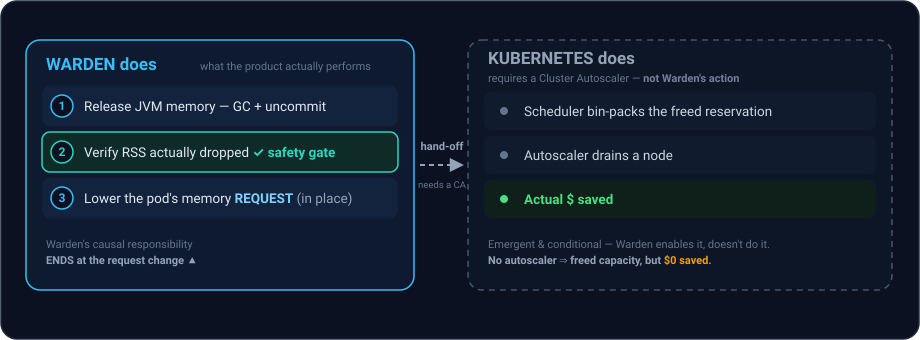

# Why Warden: the gap, the economics, and the JVM knobs

This document is the long-form *why* behind
[mnemo-jvm-warden](../README.md): which workloads it exists for, where the money
actually comes from, and which JVM mechanisms make shrinking a running heap
possible at all. The README summarizes all of this; here it is in full, with the
worked numbers.

For the *how* — components, protocol, and the resize state machine — see
[architecture.md](architecture.md).

---

## The gap Warden fills

In ~95% of production environments, [Horizontal Pod Autoscaling
(HPA)](https://kubernetes.io/docs/tasks/run-application/horizontal-pod-autoscale/)
is the right answer: scale from 10 replicas to 2 when traffic drops, and you
save money. Warden does **not** compete with that.

But there are three well-known scenarios where *removing replicas* is not an
option, and shrinking the pods you keep is the only lever left.

### 1. Minimum-replica HA baselines

High-availability architectures often can't scale below a floor — e.g. 3
sub-services × 3 replicas across 3 Availability Zones. If each JVM needs 4 GB at
peak, that's **36 GB reserved overnight to serve zero requests**. HPA can't
touch it; the floor is there for failover, not for load.

Warden keeps all 9 replicas alive for availability but shrinks each one's
footprint during the off-peak window — turning a 36 GB idle reservation into
~9 GB, **without reducing replica count**.

### 2. Slow-booting monoliths

Many enterprise Java apps (older Spring Boot, WebSphere, large multi-module
builds) take 2–5 minutes to boot and pass readiness. If HPA scales you down to 2
pods overnight and a sharp spike hits at 06:00, the new pods sit in
`ContainerCreating`/unready for minutes while the surviving 2 get slammed, spike
CPU, and cascade into an outage.

Warden keeps the pods **warm** — JVM up, classes loaded, connection pools
primed. Raising the footprint back to peak is a sub-second resize, not a cold
start.

### 3. Stateful nodes & distributed caches

For an in-memory data grid, a stateful worker queue, or a distributed cache
(this is [mnemo-cache](https://github.com/baokhang83/mnemo-cache)'s home turf),
you *can't* just kill a replica to save money — termination forces data
rebalancing, purges local cache, and thrashes surviving nodes with replication
overhead.

Warden instead **shrinks in place**: it flushes expired/evictable entries and
idle pages, runs a deep GC, uncommits the freed pages back to the OS, and keeps
the node running at a lower price point — with its hot working set intact.

---

## Where the money comes from

**Cost lives in `requests`, not `limits`.** Lowering a Pod's memory *limit*
saves nothing — you still pay for the node. Kubernetes cost is driven by
*requests*, because that's what the scheduler bin-packs against and what
[Cluster
Autoscaler](https://github.com/kubernetes/autoscaler/tree/master/cluster-autoscaler)
uses to decide it can drain and delete a node.

**Warden's action boundary ends at "lower the request."** It resizes an existing
pod in place — it never changes the number of pods (that's HPA) or the number of
nodes (that's the autoscaler). Everything past the request change is *emergent
cluster behaviour that Warden enables but does not perform*, and does not
guarantee:

  

The `⇢` is a hand-off, not a step Warden takes. On a fixed node pool with no
autoscaler, Warden's lower-request still frees *schedulable* capacity but zero
*billed* capacity — so the savings story is only as real as your consolidation
setup.

---

## The JVM knobs Warden drives

**You can't change `-Xmx` on a running JVM.** Max heap is fixed at launch. What
*is* movable at runtime is the soft ceiling and committed memory:

- **ZGC** — `SoftMaxHeapSize`, settable live via `jcmd VM.set_flag`, plus
  automatic uncommit of unused heap.
- **Shenandoah** — aggressive uncommit via `-XX:ShenandoahUncommitDelay`
  (the gold standard for returning memory to the OS).
- **G1** — `-XX:G1PeriodicGCInterval` / `-XX:G1PeriodicGCSystemLoadThreshold`
  already trigger idle GC + uncommit.

The JVM already does half of this. **Warden's job is the orchestration** — it
drives these knobs from a traffic schedule *and* coordinates them with a
Kubernetes [in-place Pod
resize](https://kubernetes.io/docs/tasks/configure-pod-container/resize-container-resources/),
which the JVM has no way to do on its own.

Boost's explicit heap target additionally requires runtime `SoftMaxHeapSize`
support (ZGC or Shenandoah); G1 remains supported by the scheduled-resize path.
See the [Boost guide](warden-boost.md) for that distinction.

---

## Warden vs. VPA

Warden's real neighbor isn't HPA — it's the [Vertical Pod
Autoscaler](https://github.com/kubernetes/autoscaler/tree/master/vertical-pod-autoscaler),
which now also supports in-place updates but is **JVM-blind**. The
feature-by-feature comparison lives in the
[README](../README.md#warden-vs-vpa).
